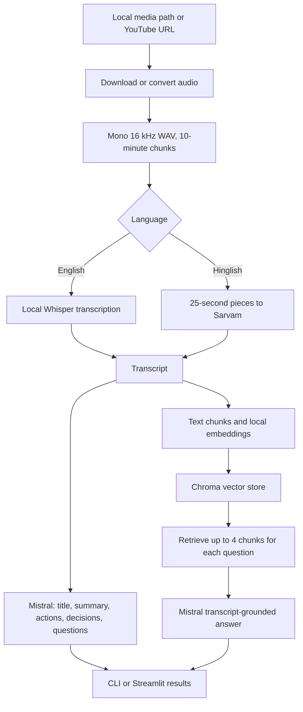

<div align="center">

# AI Video Assistant

**Turn meeting audio and video into a transcript, structured notes, and a transcript-grounded chat.**


</div>


## Contents

- [Overview](#overview)
- [Features](#features)
- [How it works](#how-it-works)
- [Project structure](#project-structure)
- [Technology](#technology)
- [Getting started](#getting-started)
- [Usage](#usage)
- [Configuration](#configuration)
- [Results and performance](#results-and-performance)
- [Privacy and security](#privacy-and-security)
- [Limitations and responsible use](#limitations-and-responsible-use)
- [Roadmap](#roadmap)
- [Contributing](#contributing)
- [License](#license)
- [Author](#author)

## Overview

AI Video Assistant is a Python application for turning a local audio/video file or a YouTube URL into meeting notes. It transcribes English audio locally with Whisper or sends Hinglish audio to Sarvam for English transcription/translation. It uses Mistral for a title, summary, action items, decisions, open questions, and a chat interface grounded in the transcript.

The project combines audio handling, speech recognition, language-model workflows, local vector search, and a Streamlit interface in one inspectable application.

## Features

- Accepts a local audio/video file path or a YouTube URL.
- Converts audio to mono 16 kHz WAV and processes it in ten-minute chunks.
- Offers English transcription with a locally run Whisper model and Hinglish transcription/translation through Sarvam.
- Produces a title, bullet-point summary, action items, key decisions, and open questions using Mistral.
- Builds a local Chroma vector store with Hugging Face sentence-transformer embeddings for transcript question answering.
- Includes both a command-line prompt flow and a Streamlit interface.

## How it works

1. `process_input` downloads audio for an HTTP(S) URL or converts a local file, then splits the WAV into ten-minute chunks.
2. `transcribe_all` routes English chunks to Whisper, or Hinglish chunks to Sarvam. The Sarvam path sends 25-second audio pieces.
3. Mistral generates a meeting title, summary, action items, decisions, and open questions from the transcript.
4. The transcript is split, embedded locally, and stored in Chroma; the chat retrieves up to four similar chunks as context for Mistral.
5. Results appear in the CLI or Streamlit page, where follow-up questions can be asked.



## Project structure

```text
.
├── app.py                  # Streamlit user interface and pipeline orchestration
├── main.py                 # Interactive CLI pipeline and transcript chat
├── core/
│   ├── extractor.py        # Action items, decisions, and open questions
│   ├── rag_engine.py       # Transcript retrieval and question answering
│   ├── summarizer.py       # Meeting title and summary generation
│   ├── transcriber.py      # Whisper and Sarvam transcription paths
│   └── vector_store.py     # Local Chroma store and Hugging Face embeddings
├── utils/
│   └── audio_processor.py  # Downloading, conversion, and audio chunking
├── Requirements.txt       # Python dependencies
├── .env.example            # Environment variable template
├── .gitignore              # Local data and secret exclusions
└── LICENSE                 # MIT license; author placeholder must be filled
```

## Technology

| Technology | Role in this project |
|---|---|
| Python | Application language (requirements recommend Python 3.10 or newer) |
| Streamlit | Browser-based interface in `app.py` |
| OpenAI Whisper | Local English speech transcription |
| Sarvam speech-to-text-translate API | Hinglish audio transcription and English translation |
| Mistral via LangChain | Title, summaries, extraction, and chat answers |
| Hugging Face Sentence Transformers | Local transcript embeddings (`all-MiniLM-L6-v2`) |
| Chroma | Local persistent vector store (`vector_db/`) |
| yt-dlp, pydub, FFmpeg | YouTube audio download and media conversion |

## Getting started

### Prerequisites

- Python 3.10 or newer is recommended by the dependency file.
- FFmpeg must be installed and available on `PATH` for pydub conversion and YouTube audio extraction.
- A Mistral API key is required for the title, summary, extraction, and chat workflows.
- A Sarvam API key is required only for Hinglish transcription. English transcription uses Whisper locally and downloads its selected model on first use if not already available.
- The Hugging Face embedding model is also downloaded when first needed. YouTube input requires network access and is subject to YouTube and content-owner terms.

### Install

Windows PowerShell:

```powershell
py -3.10 -m venv .venv
.\.venv\Scripts\Activate.ps1
python -m pip install -r Requirements.txt
Copy-Item .env.example .env
```

macOS/Linux:

```bash
python3 -m venv .venv
source .venv/bin/activate
python -m pip install -r Requirements.txt
cp .env.example .env
```

Edit `.env` and set the credentials you need. Mistral provides keys through [console.mistral.ai](https://console.mistral.ai/); Sarvam provides API access through [dashboard.sarvam.ai](https://dashboard.sarvam.ai/). Keep the real `.env` file local; `.env.example` contains placeholders only.

### Run

Start the web interface from the project root:

```powershell
streamlit run app.py
```

The same command works in macOS/Linux terminals. For the interactive CLI:

```powershell
python main.py
```

The CLI prompts for a YouTube URL or local media path, then for `english` or `hinglish`. In the web interface, provide the source in the sidebar, choose a language, and select **Analyse**. No sample media is included; use a local file you are authorized to process or a permitted YouTube URL.

## Usage

Example input: a path to an authorized local recording, such as `C:\Media\meeting.mp4`, or a YouTube URL. The application displays the generated title, summary, action items, decisions, and open questions, and supports follow-up questions against the transcript. Exact output depends on the input and external model responses; no sample results are included in the repository.

The standalone `test.py` contains a fixed YouTube source and runs the processing pipeline when executed. It may download media and make external service calls; use `main.py` or `app.py` for the interactive flows instead.

## Configuration

Set these values in `.env` or the process environment. `load_dotenv()` is called by the CLI and Streamlit entry points.

| Variable | Required | Default | Purpose |
|---|---|---|---|
| `MISTRAL_API_KEY` | Yes, for Mistral features | None | Authentication for title, summary, extraction, and chat calls. |
| `SARVAM_API_KEY` | Only for Hinglish | None | Authentication for Sarvam speech-to-text and translation. |
| `WHISPER_MODEL` | No | `small` | Whisper model name used for English transcription. |
| `SARVAM_STT_MODEL` | No | `saaras:v2.5` | Sarvam model identifier sent by the Hinglish transcription path. |

Other current pipeline settings are defined in code: audio chunks are ten minutes; Sarvam requests use 25-second pieces; transcript splitting uses 3,000 characters with 200 overlap for summarization and 500 with 50 overlap for retrieval; retrieval returns four chunks; the embedding model is `all-MiniLM-L6-v2`; Mistral uses `mistral-small-latest`.

## Results and performance

No benchmark, quality evaluation, or measured performance results are included. **<ADD: results, evaluation method, and measurements>**

## Privacy and security

- English audio transcription runs with a local Whisper model. For Hinglish, audio pieces are sent to Sarvam. YouTube URLs are downloaded through yt-dlp.
- The transcript and derived text are sent to Mistral for generation and question answering. Treat those services as external processors and review their current terms before submitting sensitive recordings.
- Embeddings and the Chroma index are stored locally under `vector_db/`; downloaded audio is written under `downloades/`. These generated folders are excluded from Git.
- API credentials are read from environment variables and `.env` via `python-dotenv`. Never commit `.env`; rotate any credential that may have been exposed.
- The current Streamlit UI renders some transcript and chat content in HTML with `unsafe_allow_html=True`. Treat untrusted input as unsafe; review HTML escaping before using the UI with untrusted content.
- Review the consent and data-handling requirements that apply to your recordings before processing them.

## Limitations and responsible use

Transcription and generated notes can omit, mishear, or misstate details; verify important decisions and assigned tasks against the source recording. Results depend on audio quality, language, and external model behavior. This project does not include an accuracy evaluation or a production reliability guarantee. Obtain appropriate consent before processing recordings that contain people, and respect copyright, platform terms, and applicable privacy laws.

## Roadmap

Ideas for future work (not implemented): add an evaluation set and benchmark, support configurable output locations, add export formats, and include a consent/privacy checklist in the UI.

## Contributing

Contributions are welcome. Open an issue to discuss a change, then submit a focused pull request with a clear description and reproduction steps. Do not include credentials, private recordings, or generated model/data files.

## License

This project is distributed under the MIT License.
## Author

**Shaik Rizwaan Ali**
